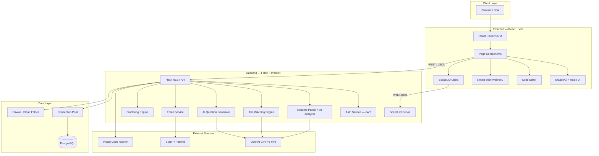
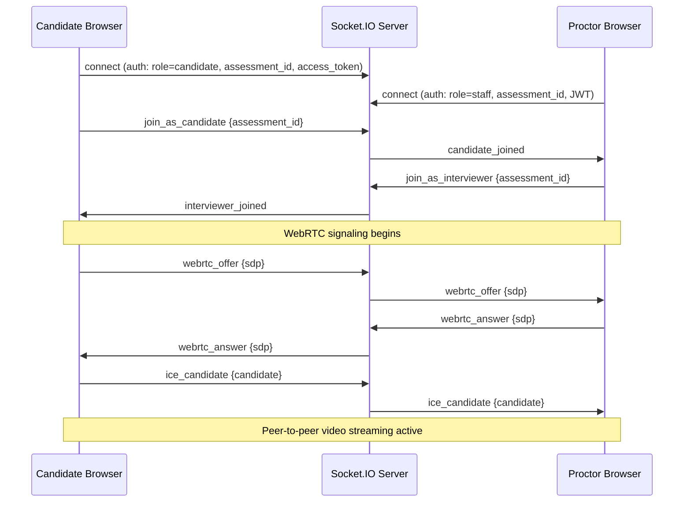
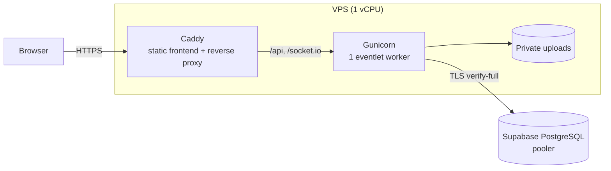

# System architecture

This document describes the architecture, design decisions, and key
components of the HireSense platform.

## High-level design

HireSense uses a decoupled architecture separating the user
interface (React SPA) from the data and logic layer (Flask REST API +
PostgreSQL). Real-time proctoring uses Socket.IO for WebRTC signaling
alongside the REST API.



## Backend architecture

The backend is built with Flask and follows a modular, service-oriented
structure. Each domain has its own blueprint registered on the main
application.

### Module overview

| Module | Responsibility |
|--------|---------------|
| `app.py` | Application setup, JWT configuration, blueprint registration, error handling, health routes |
| `run.py` | Development server entry point |
| `auth.py` | Login, demo login, current user, JWT verification |
| `admin_routes.py` | Composes the admin blueprint from `admin_users.py`, `admin_candidates.py`, `admin_content.py` (bulk upload, AI enhance, question banks), and `admin_analytics.py` |
| `admin_middleware.py` | Admin and super admin role decorators |
| `interviewer_routes.py` | Hiring review API — candidate review, scheduling, results, decisions |
| `interviewee_routes.py` | Composes the candidate blueprint from `interviewee_session.py` (token verify/start, remaining time), `interviewee_answers.py` (answers, code runs, completion), and `interviewee_monitoring.py` (violations, time sync) |
| `resume_routes.py` | Public application upload (`/api/resume/upload`) |
| `proctor_routes.py` | Proctoring API — session lists, claiming, violations, evidence, statistics |
| `job_routes.py` | Job postings, sectors, AI candidate-job matching, audit logs |
| `db_config.py` | PostgreSQL connection management and query compatibility |
| `user_db.py`, `candidate_db.py`, `assessment_db.py`, `proctoring_db.py`, `email_db.py` | Domain-specific data access |
| `resume_parser.py` | PDF/DOCX text extraction and basic skill matching |
| `resume_analyzer.py` | AI-powered resume evaluation (pros/cons, recommendations) |
| `job_matcher.py` | Rule-based + AI candidate-job matching |
| `ai_question_generator.py` | AI-generated MCQs, coding problems, and test cases |
| `questions_bank.py` | Static fallback question repository |
| `email_service.py` | Dual-transport email delivery (Resend API + SMTP) |
| `websocket_server.py` | Socket.IO server for WebRTC signaling |
| `rate_limiter.py` | Per-endpoint request rate limiting |
| `security_headers.py` | HTTP security header middleware |
| `request_logger.py` | Request logging with timing and user tracking |
| `storage_config.py` | Private upload root (`UPLOAD_FOLDER`) and path containment checks |
| `code_runner_config.py` | Whether code execution is enabled and the Piston endpoint |
| `demo_mode.py` | `DEMO_MODE` switch |
| `datetime_utils.py` | Timezone-aware parsing of client datetimes |

### Blueprint registration

```
/api/auth          → auth_bp
/api/admin         → admin_bp
/api/interviewer   → interviewer_bp
/api/interviewee   → interviewee_bp
/api/proctor       → proctor_bp
/api/jobs          → jobs_bp
/api               → resume_bp   (POST /api/resume/upload)
```

`admin_bp` and `interviewee_bp` are thin parents that register the domain
sub-blueprints listed above.

### Performance optimizations

The backend includes several optimizations for production workloads:

- **Connection pooling** — `psycopg2.pool.ThreadedConnectionPool` with
  bounds from `DB_POOL_MIN`/`DB_POOL_MAX` (defaults 1 and 8, at most 20) and an
  acquire timeout (`DB_POOL_ACQUIRE_TIMEOUT_SECONDS`).
- **Statement timeout** — `DB_STATEMENT_TIMEOUT_MS` caps long-running queries.
- **Query optimization** — Dashboard endpoints aggregate in SQL instead of
  issuing per-row queries.
- **Parallel AI work** — Question generation and bulk resume scoring run in
  thread pools so independent OpenAI calls overlap.

### AI integration

OpenAI is optional. Every AI feature defaults to `gpt-4o-mini`
(`OPENAI_MODEL`, or `OPENAI_RESUME_MODEL` for resume analysis) and falls back to
deterministic logic when no key is set or a call fails. The main uses are:

1. **Resume Analyzer** — Evaluates candidate resumes against job
   requirements. Generates structured analysis with pros, cons,
   recommendation tier, and confidence score. Falls back to rule-based
   analysis when the API is unavailable.

2. **Job Matcher** — Computes rule-based skill and experience match scores,
   then uses AI to re-rank the top 5 matches with reasoning.

3. **Question Generator** — Produces personalized MCQs, coding problems
   with test cases, and psychometric scenarios based on the intersection
   of a candidate's skills and the job description. Blends in active custom
   question banks and falls back to the static `questions_bank.py`.

Admins also use AI to rewrite job descriptions (AI Enhance) and to extract
questions from uploaded question-bank documents.

## Frontend architecture

The frontend is a single-page application built with React 18 and Vite 6.

### Routing structure

| Route | Page | Access |
|-------|------|--------|
| `/` | Landing page | Public |
| `/login` | Login (plus one-click demo sign-in when `DEMO_MODE` is on) | Public |
| `/jobs` | Job listings (`/careers` redirects here) | Public |
| `/apply`, `/apply/:jobId` | Application form | Public |
| `/assessment#token=…` | Assessment interface | Token stored in the fragment to keep it out of HTTP access logs |
| `/privacy`, `/terms` | Legal pages | Public |
| `/dashboard` | Hiring dashboard (`/interviewer-dashboard` redirects here) | JWT (interviewer, recruiter, sector_admin) |
| `/admin` | Admin dashboard (`/admin-dashboard` redirects here) | JWT (admin, super_admin) |
| `/proctor` | Proctor dashboard (`/proctor-dashboard` redirects here) | JWT (proctor) |
| `*` | 404 not found | Public |

### Component organization

```
src/
├── App.jsx              # Routes
├── main.jsx             # Entry point
├── pages/               # Route-level pages (Landing, Login, Jobs, Apply,
│                        #   Assessment, Interviewer/Admin/Proctor dashboards, Legal, NotFound)
├── components/
│   ├── ui/              # shadcn/ui primitives (button, card, dialog, etc.)
│   ├── admin/           # Admin dashboard tabs and modals
│   ├── assessment/      # MCQ, coding, and psychometric sections
│   ├── interviewer/     # Candidate details and scheduling modals
│   ├── workspace/       # Dashboard shell, metric cards, status badges
│   ├── common/          # Loading screens and spinners
│   ├── ProctorMonitor.jsx   # Proctor-side WebRTC viewer
│   ├── ProtectedRoute.jsx   # Role-gated routes
│   └── ErrorBoundary.jsx
├── contexts/            # AuthContext (staff session)
├── services/            # Axios API client and staff session storage
├── hooks/               # Toasts, demo mode, candidate camera stream
├── lib/                 # Assessment, job, and class-name helpers
└── test/                # Vitest setup
```

### Key patterns

- **State management** — `AuthContext` holds the staff session; everything
  else is component-level state.
- **Data fetching** — A single Axios client that only allows relative `/api`
  URLs. It calls the same origin by default (`VITE_API_BASE_URL` can override
  it); in development Vite proxies `/api` and `/socket.io` to the backend.
  Staff requests send the JWT, and assessment requests send the
  `X-Assessment-Token` header.
- **Component library** — Radix UI primitives wrapped with Tailwind CSS
  via shadcn/ui for accessible, consistent UI components.
- **Code editor** — A plain text-area code editor in the coding section, with
  a Python/JavaScript language picker and test runs through the backend.
- **Real-time proctoring** — Socket.IO client + simple-peer for WebRTC
  video streaming from candidate to proctor.

## Security architecture

### Authentication

- HS256 JWTs sent as `Authorization: Bearer` headers; lifetime set by
  `JWT_ACCESS_TOKEN_MINUTES` (default 60, allowed 5–480)
- Tokens are rejected when the account was deleted or updated after login
  (role, password, or any other change), so edits end existing sessions
- Candidates use a per-assessment capability token; only its SHA-256 hash is stored
- Token verification endpoint for frontend session validation

### Authorization

- Role-based access control with six staff roles (`super_admin`, `admin`,
  `sector_admin`, `recruiter`, `interviewer`, `proctor`)
- Decorators per blueprint enforce allowed roles; job and sector routes use a
  minimum-level hierarchy
- Sector-scoped access for sector admins and recruiters; interviewers and
  proctors see only assessments assigned to them

### Data protection

- Parameterized SQL queries prevent injection attacks
- Input validation on emails, IDs, and payload shapes
- Uploaded files are validated by content (PDF/DOCX/ZIP structure), renamed,
  and stored in a private upload folder served only through authorized endpoints
- 10 MB resume limit, 11 MB request body limit
- Password hashing with Werkzeug (`generate_password_hash`)
- Row-level security on every table in Supabase as defence in depth

### HTTP hardening

API responses set:

- Content-Security-Policy: `default-src 'none'; frame-ancestors 'none'`
- X-Frame-Options: DENY
- X-Content-Type-Options: nosniff
- X-XSS-Protection: 0
- Referrer-Policy: no-referrer
- Permissions-Policy denying camera, microphone, geolocation, payment, and USB
- Strict-Transport-Security outside development
- Cache-Control: no-store on sensitive and authenticated responses

The static site's own headers, including a Permissions-Policy that allows the
camera for the assessment page, are set by Caddy in `deploy/Caddyfile.hiresense`.

### Rate limiting

| Endpoint | Limit |
|----------|-------|
| Default | 5000 requests/day, 1000 requests/hour |
| Login | 10 requests/minute |
| Demo login | 20 requests/minute |
| Resume upload | 10 requests/hour |
| Bulk upload | 5 requests/hour |
| AI enhance | 30 requests/hour |
| Question bank upload | 10 requests/hour |
| Code run | 30 requests/minute |
| Coding answer submission | 6/minute and 30/hour per assessment |
| Violation report | 120/minute; screenshot evidence 6/minute and 20/hour per assessment |

Limits use Redis when `REDIS_URL` is set, otherwise in-memory storage.

## Real-time architecture

The proctoring system uses a room-based WebSocket architecture for
real-time communication.



The Socket.IO handshake is authenticated: candidates present their assessment
token, and staff present a JWT for a role that may view that assessment
(assigned interviewer or proctor, or in-sector recruiter/sector admin). Each
assessment runs in an isolated room held in the worker's memory, which is why
production runs a single worker. The server only relays signaling; video flows
peer to peer using public STUN servers (no TURN server is configured).
Rooms are cleaned up when participants disconnect.

Violation detection runs entirely in the candidate's browser, which reports
each event to `POST /api/interviewee/assessment/:id/violation`, with an
optional screenshot stored as private evidence. Face detection uses MediaPipe,
with the model and WebAssembly files self-hosted by the app (no CDN), so no
video leaves the browser for analysis. Reported types are `tab_hidden`,
`focus_lost`, `copy_paste`, `no_face`, `multiple_faces`, and
`camera_interrupted`. The WebAssembly runtime needs `'wasm-unsafe-eval'` in the
site's Content-Security-Policy (set in `deploy/Caddyfile.hiresense`).

## Deployment architecture



- **Frontend** — `npm run build` output served directly by Caddy.
- **Backend** — `hiresense.service` runs Gunicorn with one eventlet worker on
  `127.0.0.1:5000`, so Socket.IO rooms stay in one process.
- **Database** — Supabase PostgreSQL through the IPv4 pooler, as the restricted
  `hiresense_app` role.
- **Releases** — GitHub Actions deploys `main` after the checks pass; the host
  builds an immutable release and rolls back if readiness fails.

See [DEPLOYMENT_GUIDE.md](DEPLOYMENT_GUIDE.md) and
[deploy/README.md](../deploy/README.md) for details.
